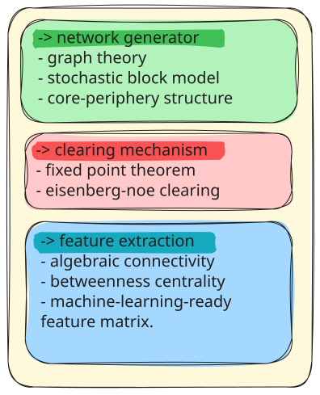

# DeepSystemic: Financial Network Contagion & Fixed-Point Predictor

An end-to-end full-stack simulation engine and interactive analytical dashboard demonstrating the systemic risk, interbank debt contagion, and random fixed-point clearing mechanisms in complex financial networks. 

Inspired by structural network science and quantitative risk research, this system bridges graph theory, linear algebra, a high-performance Python backend, and an interactive React institutional frontend.

---

## 🏗️ System Design Architecture

The application is structured into a modular pipeline mirroring core mathematical operations down to the user interface:

```
┌─────────────────────────────────────────────────────────────┐
│                    SYSTEM ARCHITECTURE                      │
├─────────────────────────────────────────────────────────────┤
│  [1. Simulation & Math Engine (models_analysis/)]           │
│      ├── Stochastic Block Model (Core-Periphery Graph)      │
│      ├── Eisenberg-Noe Fixed-Point Clearing Solver          │
│      └── Graph Laplacian & Centrality Feature Extraction    │
├─────────────────────────────────────────────────────────────┤
│  [2. REST API Service (backend/)]                           │
│      ├── POST /api/generate-network                         │
│      └── POST /api/simulate-shock                           │
├─────────────────────────────────────────────────────────────┤
│  [3. Institutional Dashboard (frontend/)]                   │
│      ├── Standalone Fallback Engine (Client-Side JS)        │
│      ├── Interactive SVG Canvas (Draggable Node Graph)      │
│      ├── Stress Test Injector Panel                         │
│      └── Real-Time Bank Clearing Ledger Table               │
└─────────────────────────────────────────────────────────────┘
```

### Concepts Workflow Map
Below is the system design architecture flow matching the foundational mathematical concepts of the platform:



---

## ⚙️ Working of the Project

1. **Network Generation (Stochastic Block Model):**
   The engine generates a synthetic interbank network exhibiting **Core-Periphery topology**. Tier-1 core banks maintain dense interconnectivity ($p_{\text{core}} \approx 0.70$) with higher liabilities, while periphery banks connect sparsely ($p_{\text{periphery}} \approx 0.05$).

2. **Shock Injection:**
   A target bank is selected along with an asset devaluation percentage (e.g., wiping out 90% of its external cash assets).

3. **Eisenberg-Noe Fixed-Point Clearing:**
   When a bank's external assets suffer a shock, it may become unable to fulfill its nominal liabilities $\bar{p}_i$. The system computes the vector of actual payments $p^*$ by iteratively updating counterparty cashflows until convergence:
   $$p_i^* = \min \left( \bar{p}_i, e_i + \sum_{j=1}^{N} \Pi_{ji} p_j^* \right)$$
   Where $\Pi_{ji} = \frac{L_{ji}}{\bar{p}_j}$ represents the relative liability matrix. If $p_i^* < \bar{p}_i$, bank $i$ defaults, reducing payments to its creditors and potentially triggering cascading default contagion.

4. **Feature & Risk Metrics Extraction:**
   - **Algebraic Connectivity ($\lambda_2$):** Computes the second-smallest eigenvalue of the Graph Laplacian $L = D - A$ to measure how resilient the network structure is against fragmentation.
   - **Betweenness Centrality:** Identifies systemic bridge nodes that facilitate financial contagion across clusters.

5. **Interactive Dashboard & Standalone Mode:**
   The UI allows users to manipulate network dimensions and shock parameters dynamically. It supports both a live backend API connection and a 100% standalone in-browser JavaScript math engine fallback.

---

## 📁 Folder Structure

```text
fin_systemic_risk/
├── backend/
│   ├── __init__.py
│   ├── main.py               # FastAPI server application & routes
│   └── schemas.py            # Pydantic validation models
├── frontend/
│   ├── public/
│   │   └── index.html
│   ├── src/
│   │   ├── components/
│   │   │   ├── Header/       # Mode toggles & connection indicator
│   │   │   ├── Controls/     # Sliders for network size & shock parameters
│   │   │   ├── NetworkGraph/ # Interactive SVG network visualizer
│   │   │   └── BankLedger/   # Financial status ledger table
│   │   ├── App.jsx           # Main React Dashboard application
│   │   ├── index.js
│   │   └── index.css         # Scoped styling setup
│   └── package.json
├── models_analysis/
│   ├── data/                 # Network export checkpoints & raw matrices
│   ├── notebooks/            # Exploratory research & numerical verification
│   ├── prerequisite_knowledge/ # Markdown documentation on core math concepts
│   │   ├── graph_laplacian.md
│   │   ├── algebraic_connectivity.md
│   │   ├── betweenness_centrality.md
│   │   └── eisenberg_noe_clearing.md
│   ├── src/
│   │   ├── network_generator.py    # SBM graph construction
│   │   ├── clearing_mechanism.py   # Fixed-point iterative solver
│   │   └── feature_extractor.py    # Laplacian & centrality metrics computation
│   ├── run_step1.py
│   ├── run_step2.py
│   └── run_step3.py
└── README.md
```

---

## 📐 Mathematical Concepts & Prerequisite Knowledge

Detailed theoretical guides are organized inside `models_analysis/prerequisite_knowledge/`:

1. **Graph Theory & Core-Periphery Structures (`network_generator.md`):**
   Models financial systemic risk using directed weighted graphs $G = (V, E, W)$, where nodes $V$ represent financial institutions and directed edges $E$ represent interbank obligations.

2. **Eisenberg-Noe Clearing & Fixed-Point Theorem (`eisenberg_noe_clearing.md`):**
   Demonstrates existence and uniqueness of the clearing vector $p^*$ on the lattice $[0, \bar{p}]$ using Tarski's Fixed-Point Theorem.

3. **Graph Laplacian Matrix (`graph_laplacian.md`):**
   Constructed as $L = D - A$, where $D$ is the degree matrix and $A$ is the adjacency matrix. Used to quantify structural connectivity and flow propagation.

4. **Algebraic Connectivity ($\lambda_2$) (`algebraic_connectivity.md`):**
   The Fiedler value (second eigenvalue of the Laplacian). Higher values indicate tightly integrated networks capable of absorbing isolated shocks, whereas low non-zero values highlight fragility.

5. **Betweenness Centrality (`betweenness_centrality.md`):**
   Measures node centrality based on shortest paths:
   $$g(v) = \sum_{s \neq v \neq t} \frac{\sigma_{st}(v)}{\sigma_{st}}$$
   Identifies key systemically important financial institutions (SIFIs).

For more information, go to [Knowledge](./knowledge/README.md)

---

## 🚀 To Run Locally

### Backend Setup (FastAPI)
```bash
# Navigate to project root
cd <project_folder>

# Create and activate virtual environment
python -m venv venv
source venv/bin/activate  # On Windows: venv\Scripts\activate

# Install dependencies
pip install -r requirements.txt fastapi uvicorn pydantic

# Start FastAPI server
uvicorn backend.main:app --reload --port 8000
```

### Frontend Setup (React)
```bash
cd <project_folder>/frontend
npm install
npm run dev
```