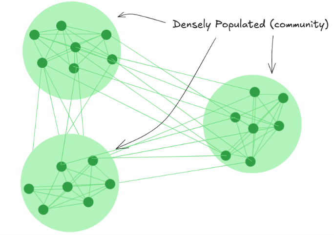

# Stochastic Block Model

* SBM is a generative model for random graphs.
* The nodes can be grouped into communities or blocks based on some similarity
criterion.
* The probability of two nodes having an edge between them depends on their
block.
* The probability of existence of edge between two nodes is higher for nodes in
sam block and lower for nodes in different blocks.

#### External Resources
* Wikipedia page on Stochastic Block Model: [LINK](https://en.wikipedia.org/wiki/Stochastic_block_model)
* Youtube video by Lauren Hyoseo Yoon: [LINK](https://www.youtube.com/watch?v=5cYBLy5Usls)